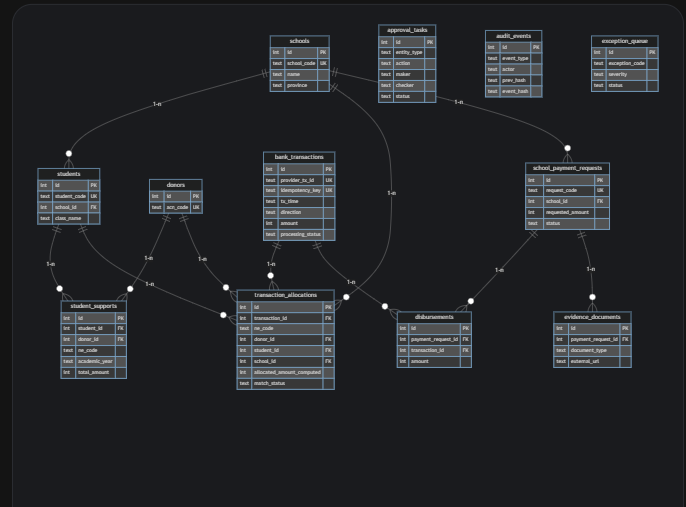
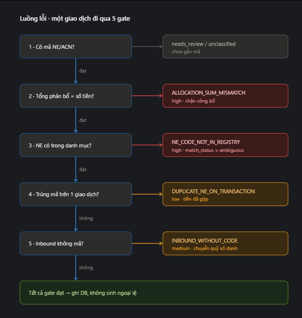
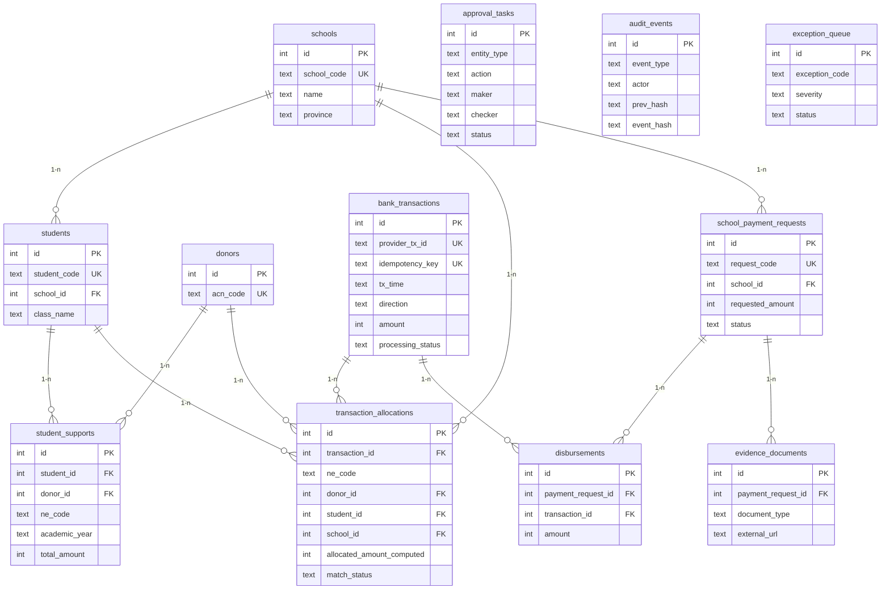

# ERD & Luồng lỗi — Nuôi Em (Topic 4)

Tài liệu nội bộ. Nguồn: `PRAGMA foreign_key_list` trên `data/nuoi_em_mvp.sqlite`
  
và code `build_database.py` / `reconciliation.py` / `parsers.py`.

## 1. ERD — quan hệ bảng

### Khóa ngoại thật (11)

| Bảng con                | Cột                | → Bảng cha              | Cột |
| ----------------------- | ------------------ | ----------------------- | --- |
| students                | school_id          | schools                 | id  |
| student_supports        | student_id         | students                | id  |
| student_supports        | donor_id           | donors                  | id  |
| transaction_allocations | transaction_id     | bank_transactions       | id  |
| transaction_allocations | donor_id           | donors                  | id  |
| transaction_allocations | student_id         | students                | id  |
| transaction_allocations | school_id          | schools                 | id  |
| school_payment_requests | school_id          | schools                 | id  |
| disbursements           | payment_request_id | school_payment_requests | id  |
| disbursements           | transaction_id     | bank_transactions       | id  |
| evidence_documents      | payment_request_id | school_payment_requests | id  |

### Bảng độc lập (không khóa ngoại)

`approval_tasks`, `audit_events`, `exception_queue`, `import_runs`,
  
`report_periods`, `roles`, `data_quality_issues`.

## 2. Luồng lỗi — mỗi gate hỏng rẽ nhánh nào

| Gate | Điều kiện đạt                       | Khi hỏng → trạng thái / ngoại lệ                                        | Mức      |
| ---- | ----------------------------------- | ----------------------------------------------------------------------- | -------- |
| 1    | Có mã NE/ACN trong memo             | `needs_review` (inbound có memo, không mã) / `unclassified` (memo rỗng) | —        |
| 2    | `sum(allocated) == amount`          | `ALLOCATION_SUM_MISMATCH`                                               | **high** |
| 3    | Mã NE có trong danh mục học sinh    | `NE_CODE_NOT_IN_REGISTRY` + `match_status=ambiguous`                    | **high** |
| 4    | Không lặp mã NE trên cùng giao dịch | `DUPLICATE_NE_ON_TRANSACTION` (tiền đã gộp, không cộng trùng)           | low      |
| 5    | Inbound có mã                       | `INBOUND_WITHOUT_CODE` (chuyển quỹ vô danh, cần hạch toán riêng)        | medium   |

Ngoài ra: `UNCLASSIFIED_INBOUND` (medium) khi memo rỗng hoàn toàn.

### Nguyên tắc

- Ngoại lệ được **gom 1 dòng/loại** kèm count + tổng giá trị rủi ro — không phải 1 dòng/lỗi.
- Gate 2 và 3 là **chặn công bố** (high): không được báo cáo khi còn lỗi này.
- Gate 4 và 5 là **nhắc chuẩn hoá** (low/medium): tiền vẫn đúng, chỉ cần người xử lý.

## 3. Ghi chú

- `transaction_allocations.ne_code` là **chuỗi**, không FK tới `students`, vì mã NE
    
  là vĩnh viễn và không tái sử dụng — FK sẽ âm thầm trỏ lại sai nếu mã bị cấp lại.
- `audit_events` append-only (trigger chặn UPDATE/DELETE) + chuỗi hash
    
  `sha256(prev_hash|event|entity|actor|body)`.
- `approval_tasks` là maker-checker: `maker != checker`, nếu trùng → `PermissionError`.

## Phụ lục — mã mermaid (import vào draw.io)

